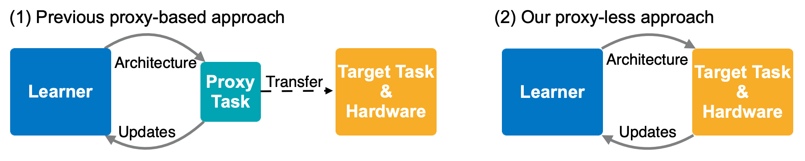
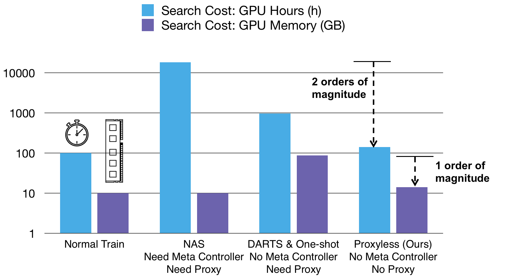
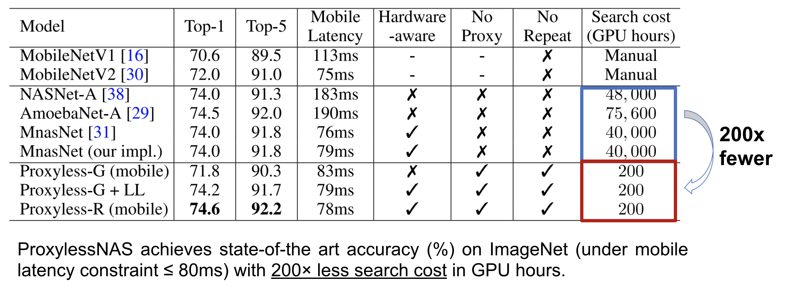
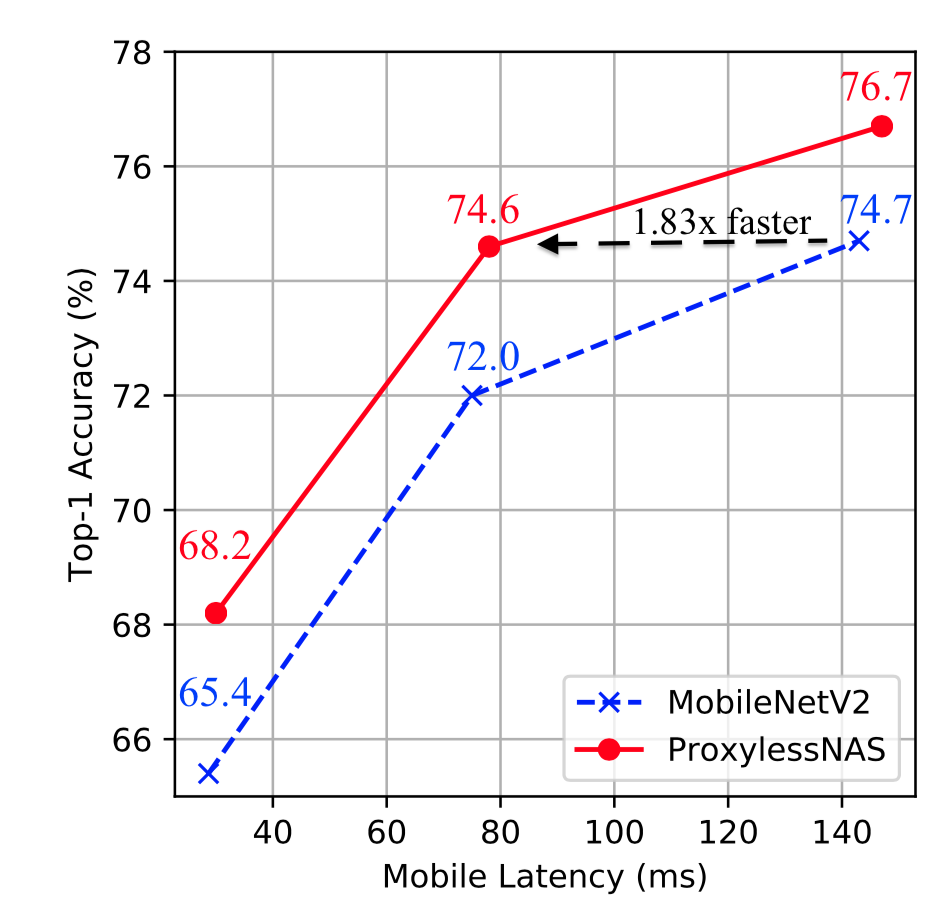
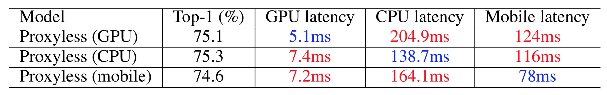
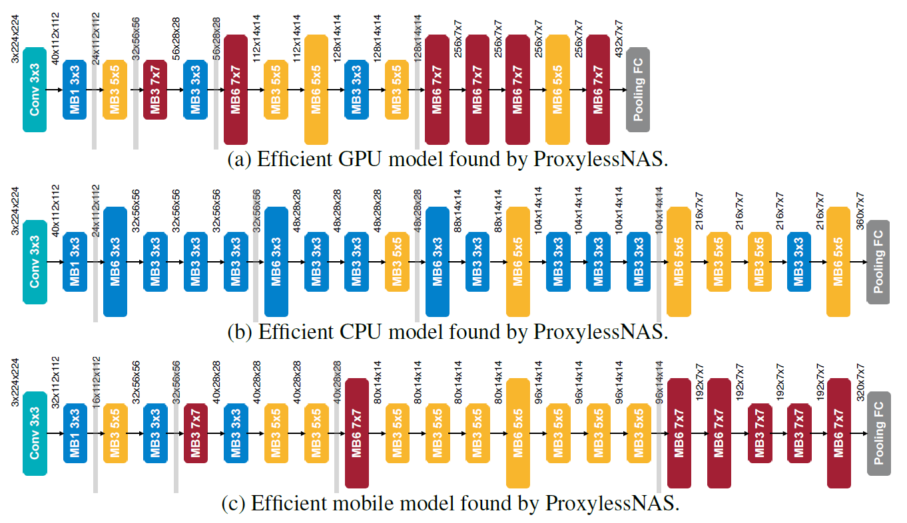
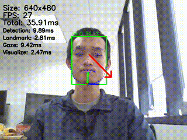

# ProxylessNAS: タスクとハードウェア上での直接的なニューラルアーキテクチャ探索（ProxylessNAS） [[arXiv]](https://arxiv.org/abs/1812.00332) [[ポスター]](assets/ProxylessNAS_iclr_poster_final.pdf)

```bash
@inproceedings{
  cai2018proxylessnas,
  title={Proxyless{NAS}: Direct Neural Architecture Search on Target Task and Hardware},
  author={Han Cai and Ligeng Zhu and Song Han},
  booktitle={International Conference on Learning Representations},
  year={2019},
  url={https://arxiv.org/pdf/1812.00332.pdf},
}
```

## ニュース
- ProxylessNAS は [PytorchHub](https://pytorch.org/hub/pytorch_vision_proxylessnas/) に統合されました。
- ProxylessNAS は Microsoft の [NNI](https://nni.readthedocs.io/en/v1.6/NAS/Proxylessnas.html) に統合されています。
- ProxylessNAS は Amazon の [AutoGluon](https://auto.gluon.ai/0.3.0/tutorials/nas/enas_proxylessnas.html) に統合されています。
- Visual Wake Words Challenge（TF-lite トラック）で1位（@CVPR 2019）
- Low Power Image Recognition Challenge（LPIRC）分類トラックで3位（@CVPR 2019）

## 性能
プロキシを用いず、ターゲットの「タスク」と「ハードウェア」上で直接かつ効率的にニューラルネットワークのアーキテクチャ探索を行います！

現在、proxylessnas は [PyTorch Hub](https://pytorch.org/hub/pytorch_vision_proxylessnas/) で利用可能です。2行で読み込めます：

```python
target_platform = "proxyless_cpu" # proxyless_gpu, proxyless_mobile, proxyless_mobile14 も利用可能です。
model = torch.hub.load('mit-han-lab/ProxylessNAS', target_platform, pretrained=True)
```



<p align="center">
    
</p>



<table>
<tr>
    <th> モバイル設定 </th><th> GPU設定 </th>
</tr>
<tr>
    <td>
    
    </td>
<td>

| モデル                | Top-1    | Top-5    | レイテンシ |
|----------------------|----------|----------|---------|
| MobilenetV2          | 72.0     | 91.0     | 6.1ms   |
| ShufflenetV2(1.5)    | 72.6     | -        | 7.3ms   |
| ResNet-34            | 73.3     | 91.4     | 8.0ms   |
| MNasNet(当方実装)     | 74.0     | 91.8     | 6.1ms   |
| ProxylessNAS (GPU)   | 75.1     | 92.5     | 5.1ms   |

</td>
</tr>
<tr>
    <th> ProxylessNAS（モバイル）はさまざまなレイテンシ設定下で一貫して MobileNetV2 を上回ります。 </th>
    <th> ProxylessNAS（GPU）は MobilenetV2 より3.1%高精度かつ20%高速です。 </th>
</tr> 

</td></tr> </table>

## 特化（Specialization）
人々は一つのモデルをすべてのプラットフォームにデプロイすることに慣れていますが、それは最適ではありません。効率を最大限に引き出すには、各プラットフォームに対してアーキテクチャを特化させるべきです。




検索プロセスの[可視化](assets/visualization.mp4)を提供します。詳細は我々の[論文](https://arxiv.org/abs/1812.00332)を参照してください。
 
# 使い方 / 評価方法 
- 使用例
    ```python
    # pytorch 
    from proxyless_nas import proxyless_cpu, proxyless_gpu, proxyless_mobile, proxyless_mobile_14, proxyless_cifar
    net = proxyless_cpu(pretrained=True) # はい、事前学習済みモデルを提供しています！
    ```
    ```python
    # tensorflow
    from proxyless_nas_tensorflow import proxyless_cpu, proxyless_gpu, proxyless_mobile, proxyless_mobile_14
    tf_net = proxyless_cpu(pretrained=True)
    ```

    上記スクリプトがダウンロードに失敗する場合は、手動で [Google Drive](https://drive.google.com/drive/folders/1qIaDsT95dKgrgaJk-KOMu6v9NLROv2tz?usp=sharing) からダウンロードし、`$HOME/.torch/proxyless_nas/` に置いてください。

- 評価

    `python eval.py --path 'Your path to imagent' --arch proxyless_cpu  # pytorch ImageNet`
    
    `python eval.py -d cifar10 # pytorch cifar10 `
    
    `python eval_tf.py --path 'Your path to imagent' --arch proxyless_cpu  # tensorflow`


## ファイル構成

- [search](./search): ニューラルアーキテクチャ探索（NAS）用のコード。
- [training](./training): 探索されたモデルを訓練するためのコード。
- [proxyless_nas_tensorflow](./proxyless_nas_tensorflow): TensorFlow 用の事前学習モデル。
- [proxyless_nas](./proxyless_nas): PyTorch 用の事前学習モデル。

## ProxylessNAS を使用したプロジェクト:
- [ProxylessGaze](./proxyless_gaze/): ProxylessNAS を用いたリアルタイム視線推定
<div align=center>
</img>
</div>

## モデル圧縮と高速化に関する関連研究:

[Once for All: Train One Network and Specialize it for Efficient Deployment](https://arxiv.org/abs/1908.09791) (ICLR'20, [コード](https://github.com/mit-han-lab/once-for-all))

[ProxylessNAS: Direct Neural Architecture Search on Target Task and Hardware](https://arxiv.org/pdf/1812.00332.pdf) (ICLR’19)

[AMC: AutoML for Model Compression and Acceleration on Mobile Devices](https://arxiv.org/pdf/1802.03494.pdf) (ECCV’18)

[HAQ: Hardware-Aware Automated Quantization](https://arxiv.org/pdf/1811.08886.pdf)  (CVPR’19, oral)
    
[Defenstive Quantization: When Efficiency Meets Robustness](https://openreview.net/pdf?id=ryetZ20ctX) (ICLR'19)

---

翻訳の続きや、翻訳ファイルをワークスペースに追加するなど希望があれば教えてください。
